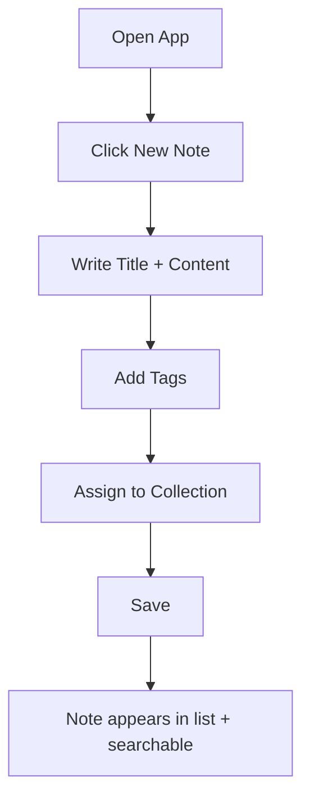
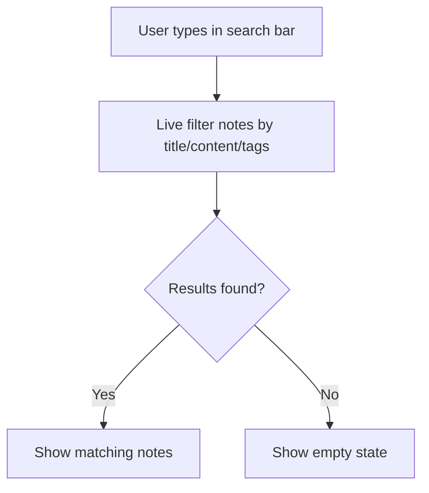
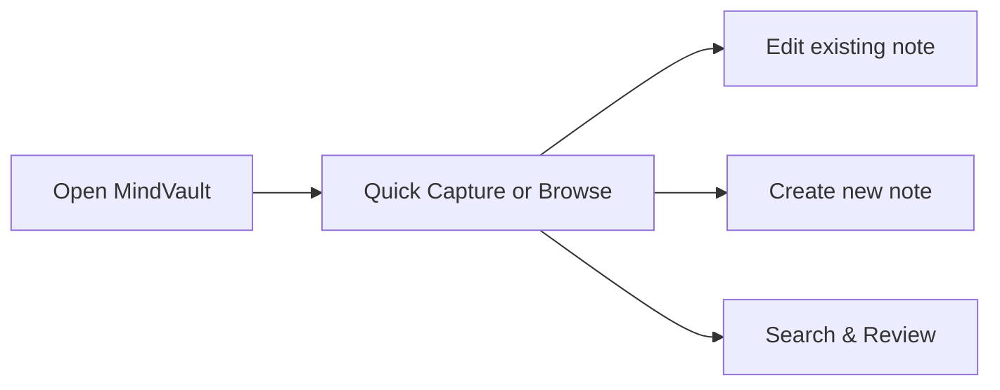
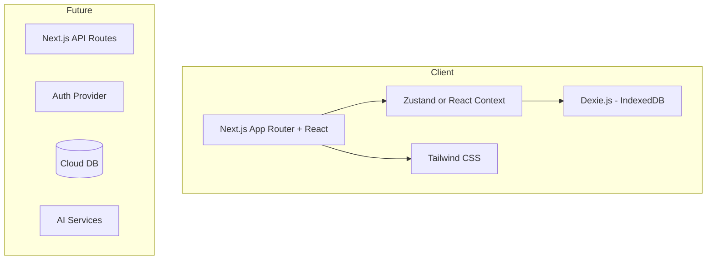

# MindVault

**Personal Knowledge & Productivity System**

A clean, modern web application for capturing notes, organizing ideas with tags and collections, and finding information quickly. Built for long-term personal use and continuous improvement over the next 5+ years.

**Live Repo:** https://github.com/sujithpannala/mindvault

---

## Project Vision

MindVault is a personal second-brain tool that helps you:
- Capture thoughts and knowledge quickly
- Organize them with tags and collections
- Find anything with fast search
- Grow into a full productivity system over time (tasks, goals, AI assistance)

**Core principle:** Simple, fast, private-first, and designed to evolve.

---

## Decisions Made

| Decision | Choice |
|----------|--------|
| **Name** | MindVault |
| **Primary Goal** | Personal knowledge base + light productivity |
| **Tech Stack** | Next.js 15 + TypeScript + Tailwind CSS |
| **Storage (MVP)** | Browser IndexedDB (via Dexie.js) |
| **Hosting** | Vercel |
| **Auth (MVP)** | None (local-only first) |
| **UI Style** | Clean, minimal, dark-mode first |

---

## Complete Project Lifecycle

### 1. Discovery & Requirements

**Target User:** Individual knowledge worker / learner / developer who wants a private place to store and organize thoughts.

**MVP Features (Must Have):**
- Create, edit, delete notes
- Markdown support
- Tags
- Collections / Folders
- Full-text search
- Dark / Light mode
- Responsive design (mobile + desktop)
- Local data persistence

**Nice-to-Have (Phase 2+):**
- Tasks linked to notes
- Goals / Projects
- AI summarization & search
- Cloud sync + multi-device
- Export / Import (Markdown, JSON)
- Keyboard shortcuts

---

### 2. User Flows

#### Primary Flow: Create & Organize a Note



#### Search Flow



#### Daily Use Flow



---

### 3. Information Architecture

```
MindVault
├── Home / All Notes
├── Collections
│   ├── Work
│   ├── Learning
│   ├── Personal
│   └── Ideas
├── Tags
├── Search
├── Settings
│   ├── Theme
│   ├── Export / Import
│   └── Data Management
└── (Future) Tasks & Goals
```

---

### 4. Design Direction

**Visual Style:**
- Minimal and calm
- Strong typography hierarchy
- Generous whitespace
- Soft borders / subtle shadows
- Accent color: Indigo / Violet

**Layout (Desktop):**
- Left sidebar: Collections + Tags
- Main area: Note list or Editor
- Right panel (optional): Note metadata / related notes

**Layout (Mobile):**
- Bottom navigation or hamburger
- Full-screen editor when writing

**Key Screens:**
1. Notes List
2. Note Editor
3. Search Results
4. Collections View
5. Settings

---

### 5. Technical Architecture



**Tech Stack Details:**
- **Framework:** Next.js 15 (App Router)
- **Language:** TypeScript
- **Styling:** Tailwind CSS + shadcn/ui components
- **Local DB:** Dexie.js (IndexedDB wrapper)
- **State:** Zustand (lightweight)
- **Editor:** @uiw/react-md-editor or Tiptap (Markdown)
- **Icons:** Lucide React
- **Deployment:** Vercel

---

### 6. Development Phases

#### Phase 1 – Foundation (Week 1-2)
- Project setup (Next.js + Tailwind + TypeScript)
- Basic layout (sidebar + main area)
- Note model + IndexedDB setup
- Create / Read / Update / Delete notes
- Markdown editor

#### Phase 2 – Organization (Week 3)
- Tags system
- Collections / Folders
- Search functionality
- Dark / Light mode

#### Phase 3 – Polish (Week 4)
- Responsive design
- Empty states & loading states
- Keyboard shortcuts
- Export notes as Markdown
- Basic settings page

#### Phase 4 – Future Enhancements
- Tasks linked to notes
- AI features (summarize, suggest tags)
- Cloud sync
- Multi-device support
- PWA (installable)

---

### 7. Quality Assurance Strategy

**Testing Levels:**
- **Unit tests:** Core logic (search, filtering, data models) with Vitest
- **Component tests:** Key UI components with React Testing Library
- **Manual testing checklist:**
  - Create / edit / delete note
  - Add / remove tags
  - Search accuracy
  - Theme switching
  - Mobile responsiveness
  - Data persistence after refresh
  - Empty states

**QA Checklist (before each release):**
- [ ] All CRUD operations work
- [ ] Search returns correct results
- [ ] Data survives browser refresh
- [ ] Dark mode works correctly
- [ ] Mobile layout is usable
- [ ] No console errors
- [ ] Accessibility basics (keyboard navigation, contrast)

---

### 8. Deployment & DevOps

- **Hosting:** Vercel (connected to this GitHub repo)
- **Environments:** Preview deployments on every PR
- **CI:** GitHub Actions for lint + type-check + tests
- **Domain:** Optional custom domain later

---

### 9. Success Metrics (Personal)

- Can I capture a thought in under 10 seconds?
- Can I find any note in under 5 seconds?
- Do I actually use it daily for 2+ weeks?
- Is the UI calm and non-distracting?

---

### 10. Long-term Roadmap (Next 5 Years)

| Year | Focus |
|------|-------|
| 2026 | Solid MVP + daily personal use |
| 2027 | Tasks, Goals, better organization |
| 2028 | AI assistance + smarter search |
| 2029 | Cloud sync + multi-device |
| 2030+ | Advanced knowledge graph / linking |

---

## Getting Started (Development)

```bash
# Clone the repo
git clone https://github.com/sujithpannala/mindvault.git
cd mindvault

# Install dependencies (after initial setup)
npm install

# Run development server
npm run dev
```

---

## Project Status

- [x] Repository created
- [x] Full project lifecycle documented
- [ ] Next.js project initialized
- [ ] Core note functionality
- [ ] Tags & Collections
- [ ] Search
- [ ] UI polish
- [ ] First deployment

---

**Built for long-term personal growth.**
